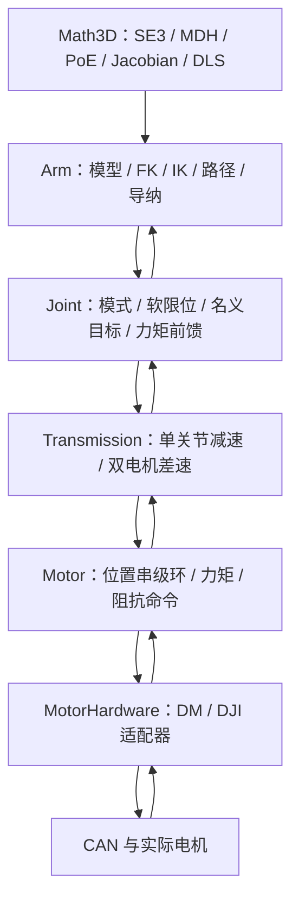

# Universal Mechanical Arm｜六轴机械臂分层控制框架

面向 STM32F405 的 C++ 机械臂控制框架，将硬件驱动、传动映射、关节语义、整臂规划与数学模型分离。重点是：**用 MDH 描述结构，用 PoE 完成运动学计算，通过虚功关系连接电机/关节/末端力矩，再以目标缓存组织轨迹与导纳控制。**

本文依据公开版本 `2d68340` 的接口与实现编写。当前 `Math3D::kDoF=6`、`Arm::kNumJoints=6`；“通用”指分层接口和模型可替换，不表示已经支持任意轴数或开箱即用的任意机械臂。

> **公开依赖边界：**SRML 为实验室内部库，未包含在公开仓库中。完整固件需经授权在本地恢复 `SRML/`；轨迹 CQC、PID 与部分滤波依赖来自该库。本文不附带内部库源码，也不以私有实现推断公开接口之外的功能。

## 导航

- [框架设计与数据流](#architecture)
- [单位、零位与 MDH 建模](#model)
- [PoE 正运动学、雅可比与逆运动学](#kinematics)
- [传动映射及虚功推导](#transmission)
- [动力学模型与前馈接口](#dynamics)
- [力矩残差、外力估计与导纳控制](#admittance)
- [轨迹、控制周期与使用示例](#usage)
- [实现边界与验证方法](#validation)

<a id="architecture"></a>
## 1. 框架设计与数据流



| 层次 | 入口 | 负责的内容 |
|---|---|---|
| 数学 | [Math3D.h](USP/Application/Arm/Math3D.h)、[Math3D.cpp](USP/Application/Arm/Math3D.cpp) | 固定大小向量/矩阵、刚体变换、旋量、正逆运动学和线性方程求解 |
| 整臂 | [Arm.h](USP/Application/Arm/Arm.h)、[Arm.cpp](USP/Application/Arm/Arm.cpp) | 六关节绑定、模型、目标缓存、轨迹、增量 IK、导纳和执行状态 |
| 关节 | [Joint](USP/Application/Joint/Joint.cpp) | 关节坐标、软限位、模式、目标及补偿量 |
| 传动 | [Transmission](USP/Application/Transmission/Transmission.cpp) | 减速比、极性、零位偏置和差速耦合 |
| 电机 | [Motor](USP/Application/Motor/Motor.cpp) | 通用模式与控制器、力矩前馈合成 |
| 硬件适配 | [DM](USP/Application/Motor/DM_motor.cpp)、[DJI](USP/Application/Motor/DJI_motor.cpp) | 反馈解码、单位转换、力矩/原生 MIT 或软件阻抗输出 |
| 动作管理 | [ActionGroupManager](USP/Application/Arm/ActionGroupManager.cpp) | 固定容量动作组注册和单组执行 |

`Arm` 持有关节的非拥有指针，传动层连接 `Motor` 与 `Joint`，应用层负责这些对象的生命周期。改变电机型号通常修改硬件适配器，改变减速/差速机构修改传动层，改变机械臂几何修改模型参数，避免业务层直接处理编码器值和 CAN 原始量。

工程已在 Keil 项目中加入这些源文件，但现有 `Service_Device.cpp` 仍保留模板任务；应用层还需要实例化机械臂、配置实际结构、绑定对象并安排周期调用。不能将“模块已加入工程”理解为已经完成某一套六轴实机的全部部署。

<a id="model"></a>
## 2. 单位、零位与 MDH 建模

### 2.1 统一数学约定

| 数据 | 实际接口约定 |
|---|---|
| `Joint` / `Motor` 位置、`Arm::fkine/ikine` 关节角 | deg |
| `Joint` / `Motor` 速度 | rad/s |
| 关节/电机力矩 | N·m |
| `Math3D` 的转动关节变量与指数映射 | rad |
| 模型内部位置 | m |
| 路径点时长和 HAL 时基 | ms |
| twist | $V=[\omega_x,\omega_y,\omega_z,v_x,v_y,v_z]^T$ |
| wrench | $F=[n_x,n_y,n_z,f_x,f_y,f_z]^T$，前 3 项是力矩，不是角速度 |

下文动力学、功率和刚度推导统一采用 SI 单位。`setModelFromMDH()` 可接收 Degrees/Radians 与 Millimeters/Meters，但这些开关只决定**模型参数**如何转换，不会改变 `Arm` 位置接口仍用 deg 的约定。

逻辑零位由电机零位、传动偏置和 MDH 的 `theta_offset` 共同决定。必须保证模型中的 $q=0$ 与关节反馈的逻辑零位一致；执行 `calibrate()` 并不等同于自动重新标定整套几何模型。

### 2.2 从 MDH 基本变换推导单节矩阵

代码使用以下 Modified DH 顺序，数组中的 $\alpha_i,a_i$ 代表该节固定的 x 轴扭转与位移参数：

$$
A_i=R_x(\alpha_i)T_x(a_i)R_z(\theta_i)T_z(d_i).
$$

逐项相乘得到 [transformation_mdh()](USP/Application/Arm/Math3D.cpp) 中的展开式：

$$
A_i=\begin{bmatrix}
c_\theta&-s_\theta&0&a_i\\
s_\theta c_\alpha&c_\theta c_\alpha&-s_\alpha&-d_i s_\alpha\\
s_\theta s_\alpha&c_\theta s_\alpha&c_\alpha&d_i c_\alpha\\
0&0&0&1
\end{bmatrix}.
$$

代码中 `sigma[i]=true` 表示转动关节，取 $\theta_i=\theta_{0,i}+q_i$；`false` 表示移动关节，取 $d_i=d_{0,i}+q_i$。这个布尔约定不要与其他工具箱中同名变量的数值约定混淆。

`Math3D` 的底层模型构建和指数映射可表达 R/P 关节，但当前 `Arm` 包装层对六个变量一律进行 deg↔rad 转换，实际应按**六转动关节框架**使用。混合移动关节还需要同步修改顶层单位处理、限位与控制接口。

### 2.3 MDH 如何转换为 PoE 模型

在逻辑零位令全部关节变量为零，依次累乘：

$$
T_i^0=A_1(0)\cdots A_i(0),\qquad M=T_6^0.
$$

从 $T_i^0$ 中提取 $z_i=R_i^0e_z$ 和轴上一点 $p_i$。对转动关节，轴上点不动，满足 $0=\omega_i\times p_i+v_i$，因此：

$$
S_i=\begin{bmatrix}\omega_i\\v_i\end{bmatrix}
=\begin{bmatrix}z_i\\p_i\times z_i\end{bmatrix}.
$$

移动关节则为 $S_i=[0^T,z_i^T]^T$。对应 `buildModelFromMDH()` 的 `M_out` 与 `Slist_out`；`Slist` 的每一列是一根**零位空间旋量轴**。在这套 MDH 顺序中代码从累乘后的 $T_i^0$ 提取当前关节轴，不能机械套用另一种 DH 约定的下标。

<a id="kinematics"></a>
## 3. PoE 正运动学、雅可比与逆运动学

### 3.1 刚体指数映射与正运动学

对 $S=[\omega;v]$ 定义：

$$
[S]=\begin{bmatrix}[\omega]_\times&v\\0&0\end{bmatrix},\qquad
[\omega]_\times x=\omega\times x.
$$

单位旋转轴的 Rodrigues 公式为：

$$
R(q)=I+\sin q[\omega]_\times+(1-\cos q)[\omega]_\times^2,
$$

$$
e^{[S]q}=\begin{bmatrix}
R(q)&\{Iq+(1-\cos q)[\omega]_\times+(q-\sin q)[\omega]_\times^2\}v\\
0&1
\end{bmatrix}.
$$

纯移动轴则退化为 $R=I,p=vq$。把六个关节相对零位的运动依次组合，得到：

$$
T(q)=e^{[S_1]q_1}e^{[S_2]q_2}\cdots e^{[S_6]q_6}M.
$$

这对应 `Math3D::fkine()`；其倒序循环从 $M$ 开始左乘，结果仍是上式顺序。`Arm::fkine()` 只在入口增加关节角度单位转换。空间 PoE 的标准定义可参阅 [Modern Robotics 4.1.1](https://modernrobotics.northwestern.edu/nu-gm-book-resource/4-1-1-product-of-exponentials-formula-in-the-space-frame/)。

### 3.2 从 PoE 微分得到空间雅可比

令 $[V_s]=\dot T T^{-1}$，对指数乘积逐项求导后，第 $i$ 个关节的贡献要经过前序变换的伴随映射：

$$
J_{s,1}=S_1,\qquad
J_{s,i}=\mathrm{Ad}_{e^{[S_1]q_1}\cdots e^{[S_{i-1}]q_{i-1}}}S_i,
\qquad V_s=J_s\dot q.
$$

对于 $T=[R,p;0,1]$，伴随矩阵为：

$$
\mathrm{Ad}_T=\begin{bmatrix}R&0\\{[p]}_\times R&R\end{bmatrix}.
$$

分别对应 `cal_Jacobian()` 和 `adjoint()`。这里返回的是**空间 twist 雅可比**，不是简单堆叠末端角速度和末端原点速度的几何雅可比：

$$
v_s=\dot p-\omega_s\times p,\qquad
\dot p=v_s+\omega_s\times p.
$$

若把 $J_s=[J_\omega^T,J_v^T]^T$ 按块写开，末端位置雅可比是 $J_p=J_v-[p]_\times J_\omega$。后续力矩映射必须与这里的坐标系和 wrench 参考点保持一致。

### 3.3 位姿误差与阻尼最小二乘 IK

当前位姿为 $T(q)$、目标为 $T_d$，先在末端系求误差，再变换到空间系：

$$
V_b=\mathrm{vee}\{\log(T(q)^{-1}T_d)\},\qquad
V_s=\mathrm{Ad}_{T(q)}V_b.
$$

在当前姿态附近使用 $J_s\Delta q\approx V_s$，求解正则化目标：

$$
\min_{\Delta q}\ \lVert J_s\Delta q-V_s\rVert^2+\lambda^2\lVert\Delta q\rVert^2.
$$

其解可写为：

$$
\Delta q=J_s^T(J_sJ_s^T+\lambda^2I)^{-1}V_s.
$$

源码先用带主元选择的 `solveLinear6x6()` 解线性方程，再乘 $J_s^T$，并未显式计算矩阵逆。对整体步长作 $\lVert\Delta q\rVert\leq\texttt{max\_step}$ 限幅后更新 $q$。默认 `lambda=0.05`、`max_step=0.2`，后者为内部弧度增量向量的范数上限。

`eomg` 与 `ev` 分别检查空间误差向量的角分量和线分量；其线分量不应直接等同于原始 TCP 欧氏位置误差。当前求解没有旋转/平移量纲加权，也没有把关节软限位或碰撞约束加入优化问题，阻尼和容差需结合模型尺度选择。

### 3.4 为什么拆成增量 IK

`updateCartesianTargetIncremental()` 将迭代工作角、目标和累计次数保存在 `Arm` 中，每周期只执行有限步，再下发中间关节目标。默认预算为 2，独立于导纳的 IK 配置；单目标累计上限默认 200。

- 目标位置某分量变化超过 `2e-4 m`，或旋转矩阵某元素变化超过 `1e-4` 时，重新从当前反馈开始。
- 返回 `true` 可能表示仍在 `RUNNING`，不表示已经到达；应同时读取 `cartesianIkConverged()`、`cartesianIkInProgress()` 和执行状态。
- 达到总迭代上限、模型未配置或模式不匹配时，停止当前求解并保持当前反馈角作为目标。
- 该接口是有限迭代的目标跟踪器，并不保证中间关节运动对应笛卡尔直线。

**当前数值边界：**`matrix_log3()` 将 $\cos\theta\geq1-10^{-5}$ 视为零旋转，对应约 $\theta\lesssim0.00447\,\mathrm{rad}\approx0.256^\circ$ 的近零区域。因此把 `eomg` 设得非常小，不能获得同样严格的真实姿态精度保证。精细任务应独立计算 FK 的位置/旋转残差，并评估近零展开及浮点精度，而不能只依赖 IK 的布尔返回值。

<a id="transmission"></a>
## 4. 传动映射及虚功推导

### 4.1 单电机减速传动

`SimpleTransmission` 约定减速比 $r$、方向 $s\in\{+1,-1\}$ 和总零偏 $b$：

$$
q=\frac{s}{r}\theta_m-b,\qquad
\dot q=\frac{s}{r}\dot\theta_m,\qquad
\theta_{m,d}=sr(q_d+b).
$$

理想传动忽略损耗，根据功率守恒 $\tau_q\dot q=\tau_m\dot\theta_m$：

$$
\tau_m=\frac{s}{r}\tau_q,\qquad \tau_q=sr\tau_m.
$$

这对应 `updateFeedback()` 与 `applyJointCommand()`。若所有角度均用同一单位，关节弹簧阻尼映射到电机侧时有 $K_{p,m}=K_{p,q}/r^2$、$K_{d,m}=K_{d,q}/r^2$，而不是与角度比例一样乘以减速比。

### 4.2 双电机差速传动

忽略零偏的导数，源码映射可写为：

$$
q=A\theta_m-b,\qquad
A=\frac12\begin{bmatrix}1&-1\\r&r\end{bmatrix},\qquad
\theta_{m,d}=\begin{bmatrix}1&1/r\\-1&1/r\end{bmatrix}(q_d+b).
$$

再次使用虚功：

$$
\tau_m=A^T\tau_q
=\frac12\begin{bmatrix}\tau_{q,0}+r\tau_{q,1}\\-\tau_{q,0}+r\tau_{q,1}\end{bmatrix},
\qquad
\tau_q=\begin{bmatrix}\tau_{m,0}-\tau_{m,1}\\(\tau_{m,0}+\tau_{m,1})/r\end{bmatrix}.
$$

对差速阻抗，完整电机刚度通常为 $K_m=A^TK_qA$，包含耦合项。因此代码先在关节空间合成阻抗力矩，再用 $A^T$ 分配给两电机；MIT 输出的本地 `kp/kd` 置零，让等效力矩承担耦合控制，而不是简单复制两个独立位置控制器。

### 4.3 模式与实际增益单位

关节支持位置、力矩、阻抗、失能四种模式。差速两关节模式不同时，当前合并优先级为**失能 → 力矩 → 阻抗 → 位置**；不能让同一差速机构两侧各自独立决定输出模式。

理论阻抗关系为：

$$
\tau=K_p(q_d-q)+K_d(\dot q_d-\dot q)+\tau_{\mathrm{ff}}.
$$

实际接口位置采用 deg，速度采用 rad/s。尤其 DM 适配器会把位置转换为 rad 再送原生 MIT，但直接透传 `kp`；DJI 软件阻抗则在 deg 位置差上计算。**当前不同适配器的刚度数值不能直接通用**：若 $K_p$ 按 N·m/rad 给出，使用度误差时需 $K_{p,\mathrm{deg}}=K_{p,\mathrm{rad}}\pi/180$。移植和整定时须先明确底层实际量纲，再应用减速比平方关系。

<a id="dynamics"></a>
## 5. 动力学模型与前馈接口

### 5.1 从质心运动得到质量矩阵

对刚体 $i$，设世界系质心位置为 $p_{c,i}(q)$，线速度与角速度分别由相应雅可比给出：

$$
\dot p_{c,i}=J_{v,i}\dot q,\qquad \omega_i=J_{\omega,i}\dot q.
$$

其总动能为：

$$
E_k=\frac12\sum_i\left(m_i\dot p_{c,i}^T\dot p_{c,i}
+\omega_i^TR_iI_{c,i}R_i^T\omega_i\right)
=\frac12\dot q^TM_q(q)\dot q,
$$

$$
M_q(q)=\sum_i\left(m_iJ_{v,i}^TJ_{v,i}
+J_{\omega,i}^TR_iI_{c,i}R_i^TJ_{\omega,i}\right).
$$

这里的 $M_q$ 是质量矩阵，区别于 PoE 的零位变换 $M$。质心雅可比不是直接拿末端雅可比替代：每个刚体需要自己的质心位置与上游关节关系。

取 $U(q)=-\sum_i m_i\mathbf g_0^Tp_{c,i}(q)$、$L=E_k-U$，代入拉格朗日方程：

$$
\frac{d}{dt}\frac{\partial L}{\partial\dot q_j}-\frac{\partial L}{\partial q_j}
=\tau_{\mathrm{act},j}+(J_s^TF_{\mathrm{env}})_j-\tau_{f,j},
$$

得到：

$$
M_q(q)\ddot q+C(q,\dot q)\dot q+g(q)+\tau_f
=\tau_{\mathrm{act}}+J_s^TF_{\mathrm{env}},\qquad
g_j=\frac{\partial U}{\partial q_j}.
$$

一种常见的 $C$ 构造为：

$$
C_{ij}=\sum_k\frac12\left(
\frac{\partial M_{q,ij}}{\partial q_k}+
\frac{\partial M_{q,ik}}{\partial q_j}-
\frac{\partial M_{q,jk}}{\partial q_i}\right)\dot q_k.
$$

这些公式给出后续接入刚体动力学模型的依据；当前框架**尚未从 MDH 自动生成质心、质量矩阵、科氏项或完整逆动力学求解器**。MDH 只有几何信息，本身不足以确定质量与惯量。拉格朗日推导背景可参阅 [Modern Robotics 8.1](https://modernrobotics.northwestern.edu/nu-gm-book-resource/chapter-8-1-lagrangian-formulation-of-dynamics-part-1-of-2/)。

### 5.2 动力学量在代码中的入口

`Joint` 将外部目标前馈和三类模型补偿合成：

$$
\tau_{\mathrm{ff,total}}=
\tau_{\mathrm{cmd,ff}}+\tau_g+\tau_f+\tau_I.
$$

| 模型量 | 关节接口 | 应用层提供的内容 |
|---|---|---|
| 保持重力力矩 | `setGravityComp()` | 根据质量、质心和姿态计算 $g(q)$ |
| 摩擦补偿 | `setFrictionComp()` | 例如 $F_c\mathrm{sgn}(\dot q)+B\dot q$ |
| 惯性项 | `setInertiaComp()` | 简化 $I_{\mathrm{eq}}\ddot q_d$ 或自定义模型项 |
| 其他前馈 | `setTargetTorqueFF()` | 未在上面重复加入的期望力矩 |

位置模式下，传动层先把总关节前馈映射到电机侧，`Motor::execute()` 再与位置/速度串级环输出相加并限幅；力矩模式直接使用映射后的目标力矩；阻抗模式使用对应的阻抗命令路径。

这是**模型计算与控制执行分离**的扩展点。不要在关节前馈和电机前馈中重复添加同一重力项；如果仅在电机层额外加补偿，后面的关节残差估计也不会自动知道这部分量。

<a id="admittance"></a>
## 6. 力矩残差、外力估计与导纳控制

### 6.1 为什么力矩映射使用雅可比转置

对匹配的空间 twist 和 wrench，末端功率与关节功率相同：

$$
P=F_s^TV_s=F_s^TJ_s\dot q=\tau_q^T\dot q
\quad\Rightarrow\quad\tau_q=J_s^TF_s.
$$

这里 $F_s$ 的力矩部分取空间原点为参考点。若原先是末端坐标系 wrench，需先做对偶变换 $F_s=\mathrm{Ad}_{T^{-1}}^TF_b$，不能只旋转力向量而忽略力矩平移项。虚功推导见 [Modern Robotics 5.2](https://modernrobotics.northwestern.edu/nu-gm-book-resource/5-2-statics-of-open-chains/)。

### 6.2 残差估计与 DLS 反解

`estimateExternalWrenchFromJointTorque()` 先计算：

$$
\tau_{\mathrm{res}}=\tau_{\mathrm{meas}}-\tau_{\mathrm{ff,total}}.
$$

随后求解 $J_s^TF_{\mathrm{res}}\approx\tau_{\mathrm{res}}$ 的正则化最小二乘问题：

$$
\min_F\ \lVert J_s^TF-\tau_{\mathrm{res}}\rVert^2+\lambda_F^2\lVert F\rVert^2
\quad\Rightarrow\quad
F_{\mathrm{res}}=(J_sJ_s^T+\lambda_F^2I)^{-1}J_s\tau_{\mathrm{res}}.
$$

当前默认 `wrench_dls_lambda=0.10`，同样通过 6×6 线性方程求解。

这里刻意称为“等效残差 wrench”：它会混入未补偿的惯性、摩擦、模型误差与控制输出，并非六维力传感器的直接测量。按上一节 $F_{\mathrm{env}}$ 为环境作用于机器人的符号约定，若前馈恰好等于完整模型动力学，则有 $F_{\mathrm{res}}\approx-F_{\mathrm{env}}$。实际使用时必须核对驱动力矩反馈与柔顺运动方向，不能仅依据函数名认定外力正号。默认未补齐模型时，准静态解释比高速动态下更可靠。

### 6.3 平移三轴虚拟质量—阻尼—弹簧

`updateAdmittanceOuter()` 只对 $f_x,f_y,f_z$ 做导纳，参考姿态的旋转部分保持不变，**不是完整六维姿态导纳**。对每个平移轴，代码实际积分的模型为：

$$
M_a\ddot x_c+D_a\dot x_c+K_a(x_c-x_r)=f_{\mathrm{res}}.
$$

参考位置固定时，令 $\Delta x=x_c-x_r$，就得到标准的 $M_a\Delta\ddot x+D_a\Delta\dot x+K_a\Delta x=f$。参考移动时，当前实现没有显式加入参考速度/加速度前馈，不能把两者在高速跟踪中视为完全相同。

离散更新先速度、后位置：

$$
\begin{aligned}
a_k&=(f_k-D_av_k-K_a(x_k-x_{r,k}))/M_a,\\
v_{k+1}&=\mathrm{clip}(v_k+a_k\Delta t,\pm v_{\max}),\\
x_{k+1}&=x_k+v_{k+1}\Delta t,\\
x_{k+1}-x_{r,k}&\leftarrow\mathrm{clip}(x_{k+1}-x_{r,k},\pm\Delta x_{\max}).
\end{aligned}
$$

外力先经二阶低通，再经过死区与限幅。默认每轴 $M_a=1.5$、$D_a=60$、$K_a=150$，力死区 0.5 N、力限幅 80 N、速度限幅 0.25 m/s、偏移限幅 0.08 m；滤波配置为 25 Hz、1000 Hz 采样和约 0.707 阻尼比。`wrench_lowpass_alpha` 只是兼容字段，当前实现未使用。

虚拟系统的 $\omega_n=\sqrt{K_a/M_a}=10\,\mathrm{rad/s}$、$\zeta=D_a/(2\sqrt{M_aK_a})=2$。这些是虚拟参数的数学含义，不是已经辨识出的实际机械臂带宽。

### 6.4 名义目标缓存与导纳目标分开


`setJointTarget()` 在导纳关闭时立即应用缓存；导纳开启时只更新名义缓存，由导纳链路输出修正目标。`getJointTargetCache()` 与 `getLastAppliedJointTarget()` 用于分别观察名义目标和实际下发值，避免把上一周期的修正目标再次当作名义输入。

外环 `updateAdmittanceOuter()` 与内层 `updateAdmittanceIkStep()` 可逻辑拆分；兼容入口 `updateAdmittance()` 顺序调用二者。它们共享内部数组和状态，接口拆分不等于已经提供跨任务线程安全。应用层应统一调度或自行同步，并避免让普通增量笛卡尔接口与导纳 IK 同时写最终目标。

<a id="usage"></a>
## 7. 轨迹、控制周期与使用示例

### 7.1 关节路径与执行状态

`ArmWaypoint` 保存六轴角度和到该点的增量时长，最多 24 个路径点。六路 CQC 使用相同起点时刻和各段时长；`Arm::update()` 通过 HAL 毫秒时基采样，先写名义缓存，再选择直接下发或进入导纳修正。CQC 内部算法属于未公开依赖，当前仓库可直接阅读的是构建、采样和接管逻辑。

加入路径点会检查数值与容量；执行前还核对点数、时长累加溢出和各关节模式。首点允许零时长，后续点禁止零时长；一般运动示例应使用正时长。连续 3 次采样失败会停止并给出 `SAMPLE_FAILED`，`stopWaypoints()` 则把目标锁定到当前反馈角。

状态码包括 `RUNNING/FINISHED`、`NOT_READY`、`MODE_MISMATCH`、`MODEL_NOT_CONFIGURED`、`BUILD_FAILED`、`IK_FAILED` 等，调用方应读取 `getLastExecStatus()`，不要只看函数返回值。

`ActionGroupManager` 提供 16 组注册、16 项队列存储和单组执行接口；但当前 `update()` 不再自动从队列取出下一组，不能把 `enqueue()` 宣传为已启用的自动连播。管理器更新会调用 `Arm::update()`，同一周期不应再额外重复调用整臂轨迹更新。

### 7.2 配置模型与绑定关节

以下示例只展示公开接口，实际电机、传动与参数由应用层提供，不预设某一套真实机械尺寸：

```cpp
#include "Arm.h"
#include "Joint.h"

bool configureArm(Arm &arm, Joint *joints[6],
                  const float alpha_deg[6], const float a_mm[6],
                  const float d_mm[6], const float theta_offset_deg[6])
{
    for (uint8_t i = 0; i < 6; ++i) {
        if (joints[i] == nullptr) return false;
        arm.bindJoint(i, joints[i]);
    }
    return arm.setModelFromMDH(alpha_deg, a_mm, d_mm, theta_offset_deg,
                              Math3D::AngleUnit::Degrees,
                              Math3D::LengthUnit::Millimeters);
}

bool startMove(Arm &arm, const float q_goal_deg[6])
{
    arm.clearWaypoints();
    return arm.addWaypoint(q_goal_deg, 1000)
        && arm.startWaypointsFromCurrent();
}
```

启用前需先更新电机反馈、完成传动与关节模式配置。`Arm::isReady()` 仅判断六个关节是否都已绑定，不替代硬件 ready、标定或故障判断。默认构造函数也不会自动建立真实模型，笛卡尔控制前必须显式调用模型配置接口。

### 7.3 推荐的周期职责

1. `Motor::update()` 读取并统一反馈，传动层 `updateFeedback()` 更新关节状态。
2. 更新一次应用层模型补偿，确定本周期唯一的名义命令来源。
3. 若周期开始时路径正在运行，调用一次 `Arm::update()`；否则按选定模式运行普通增量 IK 或导纳外环/IK。
4. 对各传动调用 `applyJointCommand()`，再对各电机调用 `execute()`，最后由通信任务发送。
5. 记录执行状态、名义目标、实际下发目标、反馈力矩、前馈和估计 wrench。

路径执行中的 `Arm::update()` 可能已经运行导纳，不能再无条件追加另一遍导纳更新。单独设置目标但没有运行路径时，`Arm::update()` 会直接返回，因此导纳需要应用层继续周期驱动。现有代码没有把这些分散接口自动编排成独立 RTOS 机械臂服务。

<a id="validation"></a>
## 8. 实现边界与验证方法

| 事项 | 当前状态 |
|---|---|
| MDH → PoE、空间 FK/Jacobian、DLS IK | 有公开实现，可独立核对 |
| 转动/移动混合轴 | 底层数学支持；顶层 `Arm` 的角度单位封装仍按六转动轴使用 |
| 刚体完整逆动力学 | 提供推导与补偿入口，未自动实现完整 $M_q/C/g$ 求解 |
| 末端力感知 | 来自力矩残差估计，有模型、符号、噪声和奇异位形影响 |
| 导纳 | 平移三轴，默认关闭；姿态沿用参考旋转 |
| IK 约束 | 无内置碰撞、关节限位优化或全局可达性保证；下游软限位裁剪不等于求解器已满足约束 |
| 内存 | 主要矩阵/状态为固定大小；路径点容器仍使用 `vector`，不是整体完全无动态分配 |
| 构建 | Keil MDK / AC6、STM32F405，完整固件依赖授权 SRML |

建议按以下顺序验证：

- **几何一致性：**同一组参数下比较 MDH 逐节连乘和 PoE；检查 $q=0$ 是否返回 $M$。
- **雅可比：**有限差分计算 $\dot T T^{-1}$，与空间雅可比各列比较；不要误用 $\dot p$ 替代空间 twist 线分量。
- **传动功率：**随机选取速度和力矩，验证 $\tau_q^T\dot q=\tau_m^T\dot\theta_m$。
- **IK：**用 FK 生成可达目标，从邻近初值求解，再用独立位置差和旋转角检查残差，覆盖近零和接近 $\pi$ 的情况。
- **控制集成：**先关闭导纳确认位置/力矩映射，再静态核对补偿与残差符号，最后观察导纳响应、限幅和执行周期。

## 9. 编译与进一步阅读

经授权恢复内部依赖后，使用 Keil MDK 打开 [MDK-ARM/Template.uvprojx](MDK-ARM/Template.uvprojx)。核对设备支持包、Arm Compiler 6、FPU 设置、CAN 参数和库版本；公开仓库自身不包含编译完整固件所需的全部内部依赖。

原模板说明保留于 [docs/legacy-template-guide.md](docs/legacy-template-guide.md)，其中旧的依赖初始化方式不代表本公开仓库包含 SRML。

- [模型与数值实现](USP/Application/Arm/Math3D.cpp)
- [整臂执行与导纳](USP/Application/Arm/Arm.cpp)
- [传动映射](USP/Application/Transmission/Transmission.cpp)
- [关节接口](USP/Application/Joint/Joint.h)
- [Modern Robotics：空间 PoE](https://modernrobotics.northwestern.edu/nu-gm-book-resource/4-1-1-product-of-exponentials-formula-in-the-space-frame/)
- [Modern Robotics：雅可比与静力映射](https://modernrobotics.northwestern.edu/nu-gm-book-resource/5-2-statics-of-open-chains/)
- [Modern Robotics：拉格朗日动力学](https://modernrobotics.northwestern.edu/nu-gm-book-resource/chapter-8-1-lagrangian-formulation-of-dynamics-part-1-of-2/)
